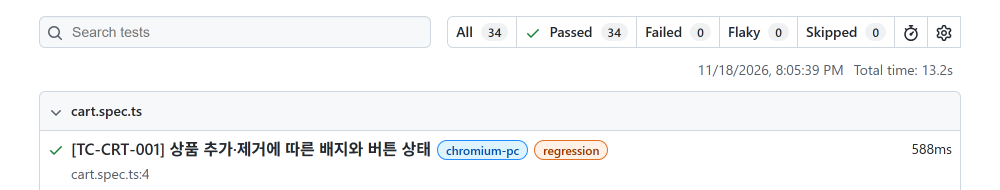
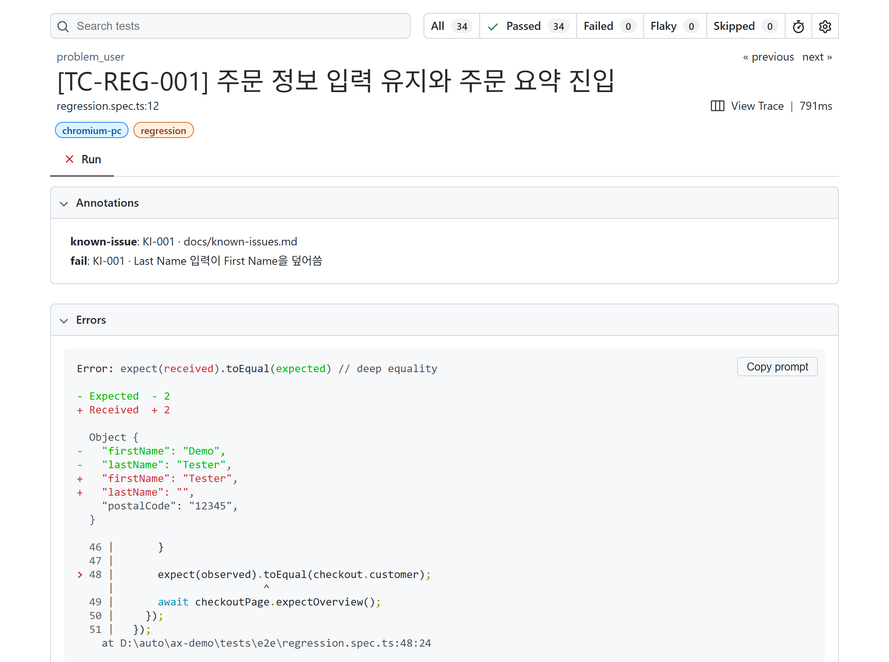

# Playwright AX 데모

AI와 QA 리뷰를 통해 공개 연습 사이트의 배포 후 핵심 구매 경로를 자동화한 포트폴리오입니다.

**실행 결과를 먼저 확인하려면 아래 리포트를 열어 주세요. 설치나 로그인이 필요하지 않습니다.**

[실행 결과 요약](https://qater97-playwright-ax-report.scentedtick3.chatgpt.site) · [전체 HTML 리포트](https://qater97-playwright-ax-report.scentedtick3.chatgpt.site/report/) · [TC 문서](docs/test-cases.md) · [결함 기록](docs/known-issues.md)

## 문제 정의

배포마다 반복하는 수동 sanity 점검을 일관되게 실행하고, 실패 원인을 확인할 수 있는 자동화가 필요했습니다. 실무 산출물은 외부 공유가 어려워 테스트 동선 확인과 AI 기반 구현 접근을 SauceDemo에서 재현했습니다. 이 저장소의 코드·증거·수치는 공개 데모에서 작성하고 측정한 자료입니다.

## 해결 방식과 AI 활용

실무에서는 **Claude Code**, 이 공개 재현 데모에서는 **Codex**를 활용했습니다.

| 단계 | AI가 수행한 작업 | 사용자 판단 및 리뷰 |
| --- | --- | --- |
| 범위 선정 | 테스트 구성과 Phase 초안 제안 | 핵심 구매 경로 선정, 잠금 계정 제외, Chromium PC·모바일 선택 |
| TC 설계 | 사이트를 직접 조작해 동작 관찰, Given·When·Then 초안 작성 | 구체화된 TC와 자동화 범위 검토 후 구현 승인 |
| 구현 | Page Object·fixture·데이터 주도 테스트 작성 | 단계별 구현 범위와 결과 검토 |
| 실패 분석 | trace·필드값·캡처 비교, 테스트 로케이터 오류 수정 및 사이트 결함 기록 | 결함 시연 포함 결정과 결과 검토 |
| 제출 증빙 | HTML 리포트·캡처 구성 | Actions 자동 실행을 제외하고 실행 결과 제공 선택 |

진행 과정, 사용자 수정 사항, 미측정 항목은 [AI 활용 기록](docs/ai-workflow.md)에 남겼습니다.

## 결과 지표

2026-11-18 공개 리포트에 게시한 실행 결과입니다.

| 지표 | 결과 |
| --- | --- |
| 자동 TC ID | 11개 |
| 데이터 반복 적용 후 | 환경당 17건 |
| Chromium PC·모바일 합계 | 34건 |
| 일반 통과 | 32건 |
| 확인된 결함의 기대 실패 | 2건 |
| 예상 밖 실패 / flaky / 재시도 | 0건 / 0건 / 0회 |
| TypeScript 검사 | 통과 |
| 수동 시각 확인 TC | 1개 · 미수행 |

Playwright의 **Passed 34** 집계에는 기대 실패 2건이 포함됩니다. 문제 계정의 알려진 증상을 확인한 경우에만 기대 실패를 적용합니다. 다른 단계나 다른 증상에서 실패하면 일반 실패로 드러납니다. 사이트에서 결함이 수정되면 정상 기대를 검증하고 알려진 결함의 상태를 재검토합니다.

## 테스트 범위

| 영역 | 검증 내용 | 설계 기법 |
| --- | --- | --- |
| 로그인 | 로그인 화면, 정상 로그인 후 상품 목록 진입 | 동등 분할 |
| 상품 | 목록·상세 이름·가격·설명 정합성, 정렬 4종과 상품 보존 | 오류 추정, 데이터 주도 |
| 장바구니 | 추가·제거, 배지·버튼 상태, 새로고침·화면 이동 후 유지 | 상태 전이 |
| 주문 | 로그인부터 주문 완료까지, 소계·세금·총액, 필수 입력 누락 3종 | 상태 전이, 오류 추정, 동등 분할, 데이터 주도 |
| 문제 계정 | 정상 계정과 동일한 입력으로 주문 정보 오류 재현 | 오류 추정, 데이터 주도 |

모바일은 **Pixel 7 에뮬레이션**입니다. 주문은 공개 연습 사이트의 완료 화면까지 확인합니다. 금액 검증은 관찰한 상품 조합의 기준금액과 합계를 사용합니다. API, 실제 카드 승인, 실물 모바일 기기 검증은 후속 확장 범위입니다.

### 대표 TC에서 실행 증거까지

| 대표 사례 | 구현 | 확인할 증거 |
| --- | --- | --- |
| TC-CHK-001 핵심 구매 경로 | [checkout.spec.ts](tests/e2e/checkout.spec.ts) → [CheckoutPage](pages/CheckoutPage.ts) | HTML 리포트에서 TC-CHK-001 검색 |
| TC-INV-002 정렬 4종 | [inventory.spec.ts](tests/e2e/inventory.spec.ts) → [InventoryPage](pages/InventoryPage.ts) | 옵션별 PC·모바일 결과 |
| TC-REG-001 계정 비교 | [regression.spec.ts](tests/e2e/regression.spec.ts) → [KI-001](docs/known-issues.md) | 계정별 입력 JSON, 오류 캡처, trace, known-issue 표시 |

## 구조와 실행 방법

~~~text
docs/          PLAN.md, test-cases.md, ai-workflow.md, known-issues.md, images/
pages/         화면 조작과 웹 우선 단언
fixtures/      테스트별 독립 로그인 준비, 계정 선택
test-data/     공개 계정명, 상품, 주문 정보, 정렬 옵션
tests/e2e/     TC ID로 시작하는 영역별 테스트
playwright.config.ts
.env.example
~~~

### 준비물

Git과 **Node.js 24.x 및 npm**을 설치하고 터미널에서 아래 명령이 실행되는지 확인합니다.

~~~text
git --version
node --version
npm --version
~~~

### Windows PowerShell에서 처음 실행하기

~~~powershell
git clone https://github.com/QAter97/playwright-ax-demo.git
cd playwright-ax-demo
npm ci
Copy-Item .env.example .env
~~~

복사한 .env 파일을 편집해 아래 값을 넣습니다. SauceDemo 로그인 화면에도 공개된 연습용 비밀번호입니다.

~~~dotenv
SAUCE_PASSWORD=secret_sauce
~~~

| 공개 계정 | 용도 |
| --- | --- |
| standard_user | 정상 기능 검증 |
| problem_user | KI-001 결함 시연 |

테스트가 계정명을 자동 선택합니다. 실제 .env는 Git에서 제외되고 .env.example은 비어 있는 설정 예시로 제공됩니다.

프로젝트 내부에 Chromium을 설치한 뒤 실행합니다.

~~~powershell
$env:PLAYWRIGHT_BROWSERS_PATH = Join-Path (Get-Location).Path '.cache/ms-playwright'
npx playwright install chromium
npm test
npm run typecheck
npm run report
~~~

npm test는 PC·모바일 모두 실행합니다. npm run report는 로컬 HTML 리포트를 열며, 종료하려면 터미널에서 Ctrl+C를 누릅니다.

Linux에서 시스템 라이브러리가 필요한 경우 Chromium 설치에 --with-deps 옵션을 사용합니다. macOS·Linux의 셸 명령은 다음과 같습니다. 해당 OS에서의 실행은 별도로 검증해야 합니다.

~~~sh
git clone https://github.com/QAter97/playwright-ax-demo.git
cd playwright-ax-demo
npm ci
cp .env.example .env
# .env에 위의 공개 연습 비밀번호를 설정
export PLAYWRIGHT_BROWSERS_PATH="$PWD/.cache/ms-playwright"
npx playwright install chromium
npm test
npm run typecheck
npm run report
~~~

### 실행 범위 선택

~~~text
npx playwright test --grep @smoke
npx playwright test --project chromium-pc
npx playwright test --project chromium-mobile
~~~

로컬 기본 재시도는 0회, worker는 최대 2개입니다. 각 테스트는 새 컨텍스트에서 실행하며 스케줄 반복 실행은 사용하지 않습니다.

### 생성되는 파일과 trace 확인

| 경로 | 내용 |
| --- | --- |
| playwright-report/ | 새 실행의 HTML 리포트와 첨부 파일 |
| test-results/ | 실패 증거, 계정 비교 trace |
| .cache/ms-playwright/ | 프로젝트 내부 Chromium |
| .cache/npm/ | 프로젝트 내부 npm 캐시 |

일반 테스트는 예상 밖 실패 시 trace·스크린샷을 보관합니다. 정상·문제 계정 비교는 두 계정의 trace를 모두 남기고, 확인된 결함에는 입력값 JSON과 오류 캡처를 첨부합니다. HTML 리포트에서 View Trace를 열거나 아래 명령으로 실행할 수 있습니다.

~~~text
npx playwright show-trace "test-results 아래에서 확인한 trace.zip 전체 경로"
~~~

공개 리포트는 제출용 실행 결과를 보관한 페이지입니다. 로컬에서 재실행한 결과는 로컬 리포트에 생성됩니다.

## 실행 화면

위 화면의 Passed 집계에는 기대 실패가 포함됩니다. 일반 통과 32건과 확인된 결함 기대 실패 2건으로 구분해 확인했습니다.

## 배운 점

- AI가 만든 로케이터도 실제 요소의 역할과 접근성 이름을 확인해야 합니다. 상세 진입에서 역할 오인과 중복 이름으로 발생한 오류를 trace 근거로 수정했습니다.
- 기대 결과를 먼저 정하고 정상 계정과 비교하면, 테스트 결함과 사이트 결함을 구분할 근거를 남길 수 있습니다.
- TC ID 수, 데이터 반복 수, 실행 환경 수를 함께 기록해야 결과 지표를 설명할 수 있습니다.
- 검토·작성 시간은 사전에 측정하지 않아 시간 절감률을 계산하지 않았습니다. 실행 도구가 보고한 시간은 각 Phase 기록에 남겼습니다.
